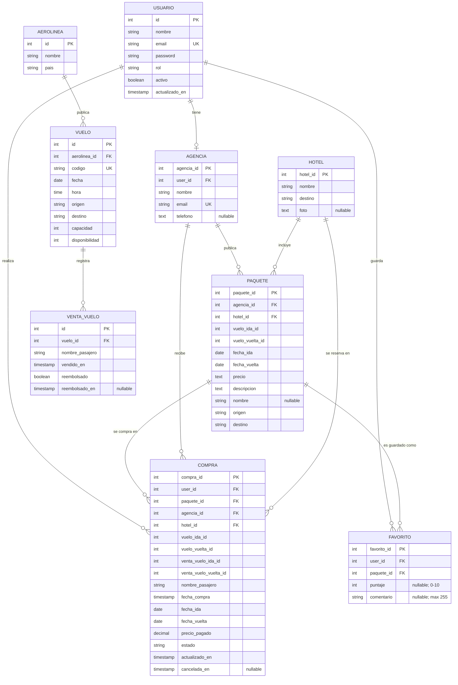

# 2026c2-pdes-grupo-5-

---

### Diagrama de Entidad de Relación



---
## Variables de configuración


| Variable | Por defecto | Descripción |
|---|---|---|
| `POSTGRES_DB` | `ctv` | Base de datos del backend principal. |
| `POSTGRES_USER` | `ctv_user` | Usuario de la base principal. |
| `POSTGRES_PASSWORD` | `ctv_password` | Contraseña de la base principal |
| `POSTGRES_PORT` | `5432` | Puerto de la base principal publicado en el host. |
| `FLIGHTS_POSTGRES_DB` | `flights` | Base de datos del servicio de vuelos. |
| `FLIGHTS_POSTGRES_USER` | `flights_user` | Usuario de la base de vuelos. |
| `FLIGHTS_POSTGRES_PASSWORD` | `flights_password` | Contraseña de la base de vuelos. |
| `FLIGHTS_POSTGRES_PORT` | `5433` | Puerto de la base de vuelos publicado en el host. |
| `JWT_SECRET` | `replace-this-secret` | Clave compartida para firmar y verificar JWT.|
| `ADMIN_NAME` | `Admin` | Nombre de la cuenta admin|
| `ADMIN_EMAIL` | `admin` | Usuario/email de la cuenta admin. |
| `ADMIN_PASSWORD` | `123456` | Contraseña inicial del administrador. |
| `FLIGHT_API_URL` | `http://flights-api:3001` | URL interna de Flight API usada por el backend. |
| `VITE_API_URL` | `http://localhost:3000/api` | URL del backend. |
| `VITE_FLIGHT_API_URL` | `http://localhost:3001` | URL de Flight API que usa el frontend en el navegador. |

---
# Usuarios creados por defecto

| Usuario | Email | Password |
|---|---|---|
| `admin`       |           -               | `123456` |
| `Comprador`	| `comprador@ctv.com`	    | `comprador123` |
| `Comprador`	| `lucia@comprador.com`	    | `comprador123` |
| `Comprador`	| `martin@comprador.com`	| `comprador123` |
| `Comprador`	| `sofia@comprador.com`	    | `comprador123` |
| `Agencia`	    | `agencia@ctv.com`	        | `agencia123` |
| `Agencia`	    | `patagonia@agencia.com`	| `agencia123` |
| `Agencia`	    | `solymar@agencia.com`	    | `agencia123` |

## Cómo levantar el proyecto.

### Levantar los contenedores

1. Para Windows:
   
```
            docker compose up --build
```
2. Para Linux:

```
            sudo docker compose up --build
```

    Esto levanta el backend CTV y sus dependencias configuradas en Docker Compose:

    - **Flight Api** : La api en el puerto 3001
    - **ctv-backend** : backend en el puerto 3000
    - **ctv-postgres** : base CTV en el puerto 5432
    - **flights-postgres** : base de vuelos en el puerto 5433

### bajar los contenedores

1. Para Windows:
   
```
            docker compose down -v
```
2. Para Linux:

```
            sudo docker compose down -v
```

---
# URL
 ### REGISTRAR
```bash
    http://localhost:5173/registro
```
 ### LOGIN
```bash
    http://localhost:5173/login
```
 ### INICIO -> una vez logueado
1. comprador
   
```bash
    http://localhost:5173/paquetes
```
2. agencia
   
```bash
    http://localhost:5173/agencia
```

3. admin

```bash
    http://localhost:5173/admin/agencias
```

---

### Integrantes

- Manchali, Damian
- Quaglia, Sebastian
- García, Axel
