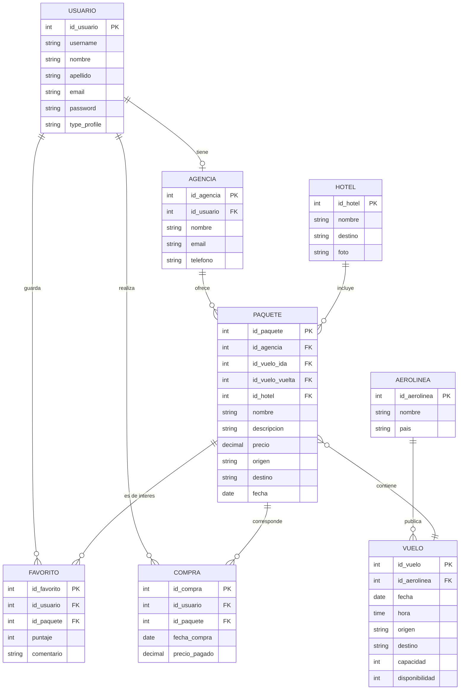

# 2026c2-pdes-grupo-5-

---

### Diagrama de Entidad de Relación


---
## Cómo levantar el proyecto.

### Levantar los contenedores

1. Para Windows:
   
```
            docker compose up --build
```
2. Para Linux:

```
            sudo docker compose up --build
```

    Esto levanta el backend CTV y sus dependencias configuradas en Docker Compose:

    - **Flight Api** : La api en el puerto 3001
    - **ctv-backend** : backend en el puerto 3000
    - **ctv-postgres** : base CTV en el puerto 5432
    - **flights-postgres** : base de vuelos en el puerto 5433

### bajar los contenedores

1. Para Windows:
   
```
            docker compose down -v
```
2. Para Linux:

```
            sudo docker compose down -v
```


---

### Integrantes

- Manchali, Damian
- Quaglia, Sebastian
- García, Axel
